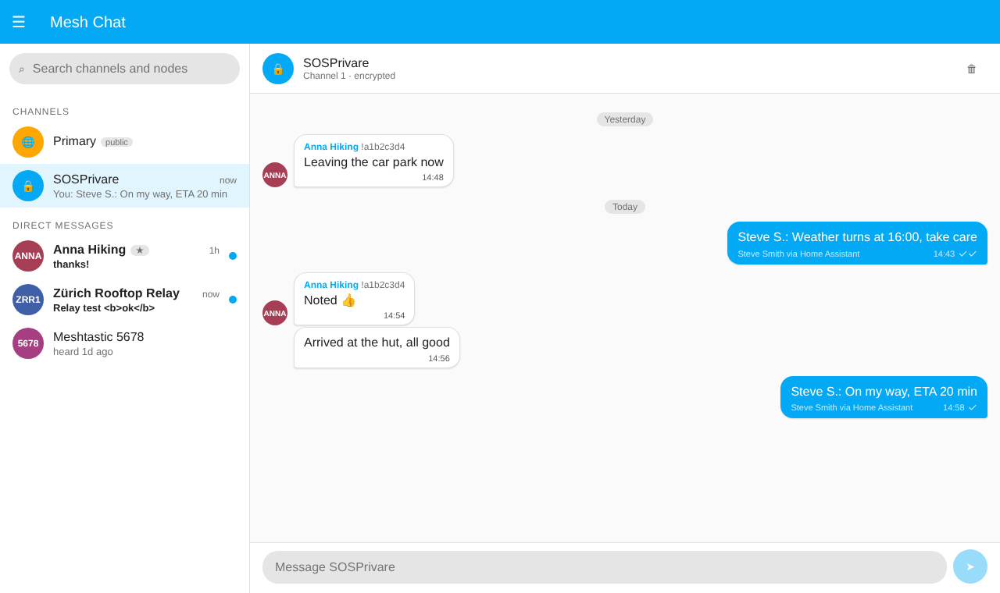
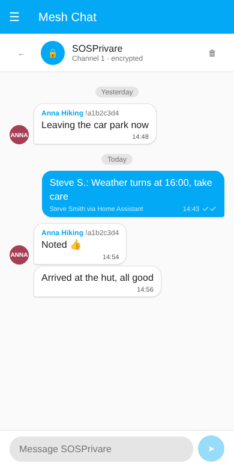
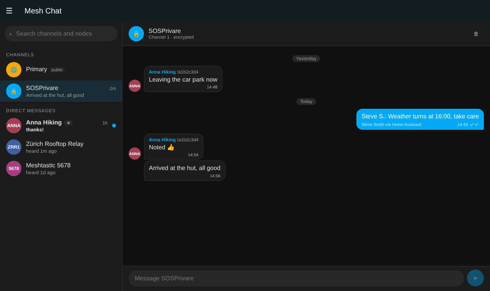
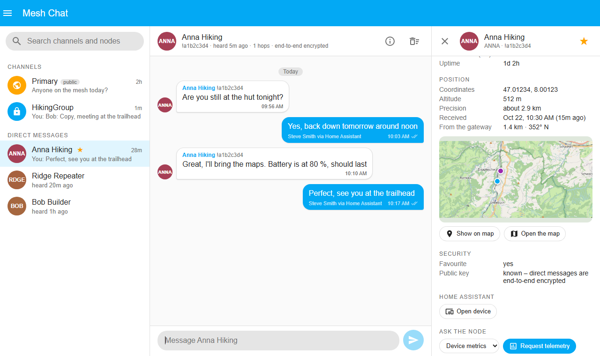
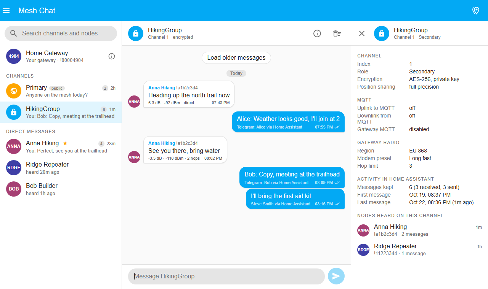
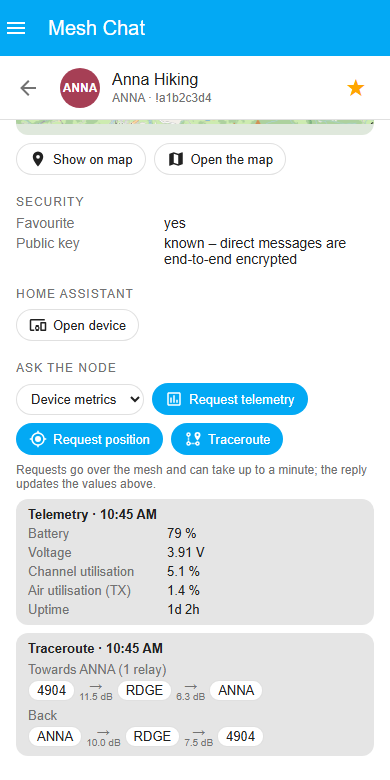
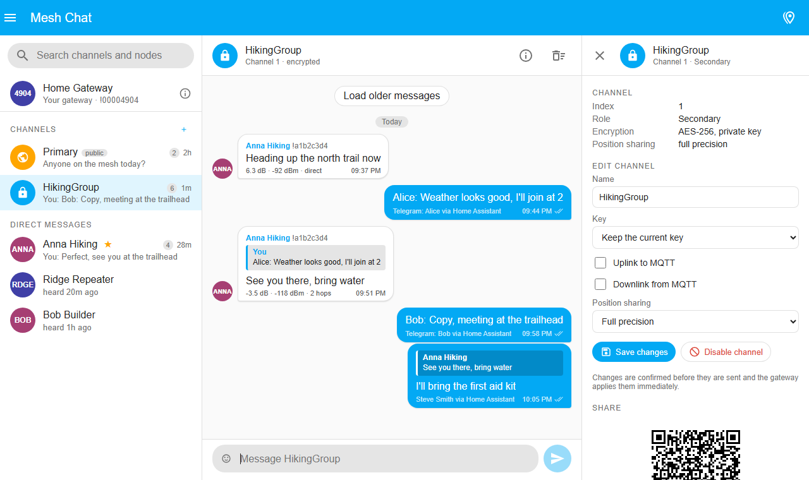
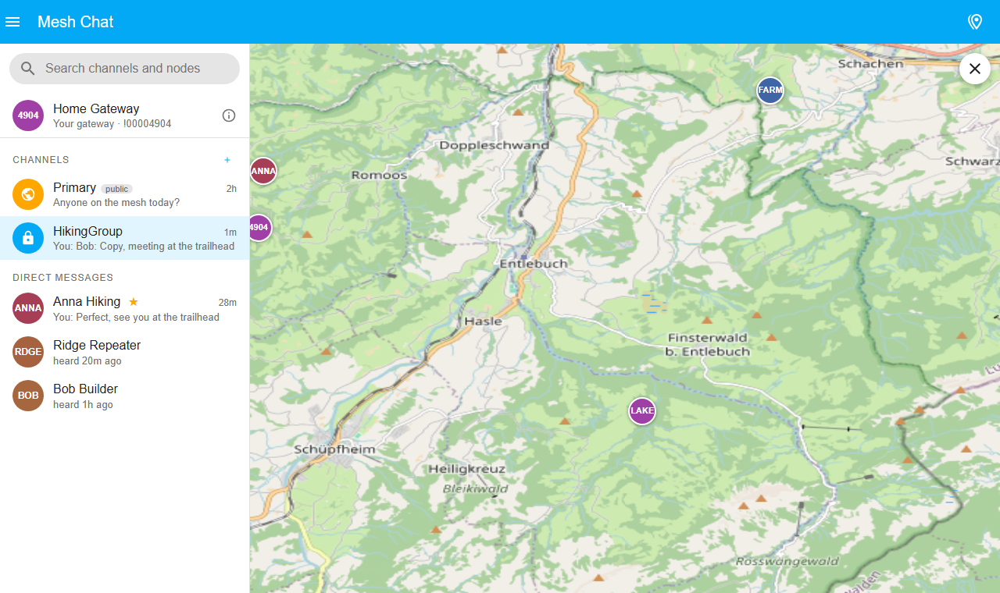

<!--
SPDX-FileCopyrightText: 2024-2025 Pascal Brogle @broglep
SPDX-FileCopyrightText: 2025 Ylian Saint-Hilaire @ylianst

SPDX-License-Identifier: MIT
-->

# Home-Assistant Meshtastic Integration

[![GitHub Release][releases-shield]][releases]
[![License][license-shield]](LICENSE)

[](https://hacs.xyz/docs/faq/custom_repositories)
[](https://buymeacoffee.com/broglep)


_Home Assistant Integration for [Meshtastic](https://www.meshtastic.org)._

Supported Features:
 * Add meshtastic devices as gateways to interact with the mesh
   * Supports TCP, Serial & Bluetooth connection (also works with [Bluetooth Proxy](https://esphome.io/components/bluetooth_proxy.html))
   * Home Assistant Zeroconf, Bluetooth & USB-Serial Auto-Discovery 
   * Select which meshtastic nodes should be imported to home assistant
 * Meshtastic node metrics
 * Record received messages
 * Send messages (as direct message or on broadcast channel)
 * Record node position (as device tracker)
 * Device triggers & actions for automations
 * Various other service actions (e.g. request metrics, trace route)
 * Bundled meshtastic web client for manual interaction with gateway
 * Mesh Chat sidebar panel to read and send channel and direct messages from Home Assistant
 * MQTT client proxy support (forwards messages from radio to MQTT broker)

For more details, see check the [documentation](#documentation).

## Installation

### Recommended: [HACS](https://www.hacs.xyz)

1. Add this repository as a custom repository to HACS: [](https://my.home-assistant.io/redirect/hacs_repository/?owner=meshtastic&repository=home-assistant&category=integration)
2. Use HACS to install the integration.
3. Restart Home Assistant.
4. Set up the integration using the UI: [](https://my.home-assistant.io/redirect/config_flow_start/?domain=meshtastic)

### Alternatives
<details>
<summary>Alternatives</summary>

### Manual
1. Using the tool of choice open the directory (folder) for your HA configuration (where you find `configuration.yaml`).
2. If you do not have a `custom_components` directory (folder) there, you need to create it.
3. In the `custom_components` directory (folder) create a new folder called `homeassistant-meshtastic`.
4. Download _all_ the files from the `custom_components/meshtastic/` directory (folder) in this repository.
5. Place the files you downloaded in the new directory (folder) you created.
6. Restart Home Assistant
7. In the HA UI go to "Configuration" -> "Integrations" click "+" and search for "Meshtastic"
</details>

### Configuration is done in the UI

<!---->

# Documentation

## Supported Platforms
### Sensor / Binary Sensor
For nodes selected as part of the configuration, metrics are exposed as corresponding sensors.

Even though integration is classified as `local_polling` it predominantly operates as `local_push` and home assistant is notified
as soon as new state is available. Polling is only used as fallback should the push mechanism stop working.

### [Notification](https://www.home-assistant.io/integrations/notify/)
Using notification platform and the generated `notify.mesh_*` entities is the recommended way to send messages to the mesh when you don't need control over all the details 
(which gateway to use, acknowledgements, etc.)

Depending on your needs, all nodes from the gateway's node database as well as the channels can be made available as notification targets.


Note: Support is based on new [entity notification platform](https://developers.home-assistant.io/blog/2024/04/10/new-notify-entity-platform/), 
for an example on how to use it, see [official documentation](https://www.home-assistant.io/integrations/notify/#example-with-the-entity-platform-notify-action).

### [Automation](https://www.home-assistant.io/docs/automation/)

For nodes selected as part of the configuration, device triggers and device actions are available.
Prefer using device actions and triggers in your automation over using (service) actions.

#### Triggers
There are triggers when messages have been sent or have been received.
Gateway nodes offer more triggers than other nodes. You can further refine the triggers to only fire when a message was 
sent/received on a particular channel or as direct message.


#### Actions
 * Send Direct Message
 * Request Telemetry
 * Request Position

Note: Ensure you have a delay before the action if your automations are triggered by meshtastic device trigger,
otherwise you risk that your action triggered message is being dropped by meshtastic firmware because
it is still busy with receiving / sending other mesh messages.

#### Examples
<details>
<summary>Reply back after message received from predefined device on arbitrary channel (including direct message) </summary>

```yaml
- id: '1800000042000'
  alias: Ping Sample
  description: 'Reply back after message from device'
  triggers:
  - device_id: e3376b45b4912c27cffb46c58e4998e4
    domain: meshtastic
    type: message.sent
    trigger: device
  actions:
  - delay:
      seconds: 10
  - device_id: e3376b45b4912c27cffb46c58e4998e4
    domain: meshtastic
    type: send_message
    message: PONG {{ trigger.event.data.message }}
```

</details>

<details>
<summary>Echo incoming channel text messages from any node with gateway device trigger</summary>

```yaml
- id: '1735857524502'
  alias: Echo Channel Message
  description: ''
  triggers:
  - domain: meshtastic
    device_id: 16efde6990a6a09903153abb8624fe38
    type: channel_message.received
    entity_id: meshtastic.gateway_brig_channel_primary
    trigger: device
  conditions: []
  actions:
  - delay:
      seconds: 5
  - action: meshtastic.broadcast_channel_message
    metadata: {}
    data:
      ack: true
      channel: meshtastic.gateway_brig_channel_primary
      message: 'ECHO: {{ trigger.event.data.message }}'
  mode: single
```
</details>

<details>
<summary>Advanced: Handling incoming text messages from any node without notification platform and its entities</summary>

```yaml
- id: '1735852176270'
  alias: Echo on Channel Message (without Notify Platform)
  description: 'Only from gateway with node id 3771721320 and channel 0'
  triggers:
  - trigger: event
    event_type: meshtastic_api_text_message
    event_data:
      data:
        to:
          node:
          channel: 0
        gateway: 3771721320
  conditions: []
  actions:
  - delay:
      seconds: 5
  - action: meshtastic.send_text
    data:
      ack: true
      text: 'ECHO: {{ trigger.event.data.data.message }}'
      from: '{{ trigger.event.data.data.gateway }}'
      channel: '{{ trigger.event.data.data.to.channel }}'
  mode: single
- id: '1735852176271'
  alias: Echo on Direct Message (without Notify Platform)
  description: 'Only from gateway with node id 3771721320'
  triggers:
  - trigger: event
    event_type: meshtastic_api_text_message
    event_data:
      data:
        to:
          node: 3771721320
          channel:
        gateway: 3771721320
  conditions: []
  actions:
  - delay:
      seconds: 5
  - action: meshtastic.send_text
    data:
      ack: true
      text: 'ECHO: {{ trigger.event.data.data.message }}'
      from: '{{ trigger.event.data.data.gateway }}'
      to: '{{ trigger.event.data.data.from }}'
  mode: single
```

If you don't want to use the recommend notification platform for sending messages (e.g. if you don't want to clutter your Home Assistant instance with potentially hundreds of notify mesh entities), 
you can still handle incoming text messages from any public node and reply to these messages. 
This is useful if to want to reply to incoming direct messages with a standard message, use a LLM or handle various commands with automations.

To do this, create a new Home Assistant automation that triggers on "Manual Events" and put `meshtastic_api_text_message` as the "Event Type". This will cause this automation to get triggerred on all incoming channel and direct messages. You will get events that include this information:

```yaml
trigger:
  event:
    event_type: meshtastic_api_text_message
    event_data:
      data:
        from: 1127918844
        to:
          node: null
          channel: 0
        gateway: 862525748
        message: Sample Message
```

From contains the node id of the sender of the message, to will have the node id of the gateway for direct messages, or a gateway channel id if the message is directed at the channel. 
Note that the channel id is dependent on the gateway node, so make sure you are using the proper gateway node when replying using that channel id. 

You can create conditions in the automation to filter out the incoming messages you want or you can directly filter in the trigger.
For example to filter out messages addressed to your gateway node, use this condition with your node id.

```
{{ trigger.event.data.data.to.node == 862525748 }}
```

To filter out messages addresses at the primary channel (Channel 0 is typically LONGFAST), use this condition:

```
{{ trigger.event.data.data.to.channel == 0 }}
```

You can also forward these messages as notifications to your phone, etc. For example:

```
Meshtastic message from ({{ trigger.event.data.data.from }}): {{ trigger.event.data.data.message }}
```

To reply to a text message in this situation, add a 2 second or more delay action and then an action called `Meshtastic 'Send Text'` to your automation. You need to add a short delay to make sure your Meshtastic device is idle before replying. Change the `Meshtastic 'Send Text'` action to edit in yaml and change the `to`, `from` and `text` values to something like his:

```
action: meshtastic.send_text
metadata: {}
data:
  ack: false
  from: "{{ trigger.event.data.data.gateway }}"
  to: "{{ trigger.event.data.data.from }}"
  text: "ECHO: {{ trigger.event.data.data.message }}"
```

In the example above, we echo back an incoming direct message.

</details>

### [Logbook](https://www.home-assistant.io/integrations/logbook/)

Direct messages or channel messages are recorded in the log book. 
Each gateway has an entity for direct messages and its channels, you can navigate to the device and select the entitiy
to see an extract of the logbook, or you can navigate to the logbook and filter for the desired entities there. 

Note: When logbook is not enabled, messages are not recorded.

### [Device Tracker](https://www.home-assistant.io/integrations/device_tracker/)

For nodes selected as part of the configuration, their position is exposed as a device tracker.
You can see the nodes on home assistant map accordingly and home assistant will report if 
node is at home or away.

### Services / [Actions](https://developers.home-assistant.io/blog/2024/07/16/service-actions/)

Use the available actions if you need more control compared to other methods to interact with
meshtastic devices. Certain actions need you to understand meshtastic details and are not recommended 
for the average user. 

## [Meshtastic Web Client](https://meshtastic.org/docs/software/web-client/)

In order to enable manual interaction with gateway nodes and because of the limitation of meshtastic firmware
that only allows one single connection, this integration offers a workaround by exposing a meshtastic client http api
for each configured gateway. The bundled meshtastic web client can then be connected
to this integration directly and the integration will act as a proxy.

This also has the added benefit that it allows you to connect to meshtastic devices via the web client
that are not connected via TCP (like serial or bluetooth) or don't support TCP at all (e.g. nRF based nodes).

**Security Note**: As a side effect, enabling this feature results in unauthenticated access to your gateway nodes for 
anyone that can reach your home assistant instance (because meshtastic does not support authentication on the http api).
Make sure to only use this feature if your home assistant instance is running in a trusted environment!

To access the web client, perform the following steps:

In Home Assistant:
1. Enable the feature in the integration configuration
2. Navigate to the "Meshtastic" menu item. If you don't see it, reload home assistant interface
3. Press the "Open" button of the desired gateway to launch the web client

Inside the Meshtastic Web Client:

4. Press "New Connection" - the correct hostname is already populated
5. Press "Connect"

## Mesh Chat

Mesh Chat adds a sidebar panel to read and send messages through your gateways, without a second connection to the node
and behind Home Assistant's own login. Every message the gateway hears is kept, together with everything sent from
Home Assistant, so the history is the same on every device you open Home Assistant on.

<p align="center"></p>
<p align="center"> &nbsp;&nbsp; </p>

- Channels and nodes are taken from the gateway, so new nodes appear as the gateway hears them.
- One conversation per channel and per node, with unread markers and search.
- Sent messages show their delivery state: heard by the mesh, acknowledged by the recipient (direct messages),
  no acknowledgement, or failed with the routing error.
- Messages sent from the chat are also recorded in the logbook next to received ones.
- Works on phones: the list and the conversation are shown one at a time on narrow screens, and the panel follows
  your Home Assistant theme.

### Enabling Mesh Chat

1. Settings → Devices & services → **Meshtastic** → open the gateway's entry → **Configure**
2. Expand **Mesh Chat** at the bottom, turn on **Enable Chat** and submit
3. Reload the browser: **Mesh Chat** appears in the sidebar

The same options are offered as the last step when a new gateway is added. The panel is visible to administrators,
and to every user once a gateway allows non-administrators (see the options below).

### Using the chat

| Element | Meaning |
|---|---|
| Lock / globe on a channel | encrypted channel / public channel (default key, anyone in range can read it) |
| Star on a node | favourite on the gateway; favourites are listed first, then by last message or last heard |
| Blue dot | unread messages in that conversation |
| `✓` on a sent message | heard by the mesh (a neighbour relayed it) |
| `✓✓` on a sent message | acknowledged by the recipient (direct messages) |
| `?` on a sent message | no acknowledgement within a minute |
| `!` on a sent message | failed, with the routing error as tooltip |
| "… via Home Assistant" under a message | which Home Assistant user, automation or bridge sent it |
| Byte counter next to the composer | Meshtastic text messages are limited to 200 bytes, prefix included |
| Bin icon in the header | administrators can delete the stored history of a conversation; messages on devices are not affected |
| Name or ⓘ in the header | opens the details of the node or channel (see below) |

### Node details, favourites and the map

Hovering a node in the list shows the essentials: hardware, role, when it was last heard, hops, SNR and battery.
Clicking the name in the conversation header opens the details pane; on phones it replaces the conversation.

<p align="center"></p>

For a **node** the pane shows the user ID, hardware and role, how it was last heard (time, hops, SNR, RSSI, via MQTT),
the last device metrics the gateway received (battery, voltage, channel and air utilisation, uptime), the position with
its precision and age, the favourite and public-key flags and, when the node has one, a button to its Home Assistant
device. The **Ask the node** buttons send the integration's existing requests over the mesh – telemetry (device,
environment, power or air quality metrics), position and traceroute – and show the reply, including the route with the
SNR of every hop. Requests can take up to a minute.

**Favourites** – the star next to a node (in the list and in the details pane) stores the favourite in the gateway's
node database, exactly like the Meshtastic apps do, so the gateway's own screen and every client connected to it see it
too. Favourites are listed first. Setting favourites changes the device, so it is limited to Home Assistant
administrators; reading details and sending requests follow the gateway's "Only administrators" option like the chat.

**Map and location** – when the node has a position the pane shows the distance and bearing from the gateway and
a small map with the node and the gateway; *Open the map* opens the full map view centred on the node. No external
map service is involved: the map is Home Assistant's own map engine.

<p align="center"> </p>
<p align="center"></p>

For a **channel** the pane shows the index and role, the encryption (public default key, AES-128 or AES-256), MQTT
uplink and downlink together with the gateway's MQTT state, the position precision shared on the channel, the gateway's
region, modem preset and hop limit, and the activity in the stored history: how many messages were kept, the first and
last one and the nodes heard on the channel – click one to open its direct messages.

### Channel management

Channels are read-only until the **Channel management from the chat** option is set to *Administrators only* or
*All chat users*. Then the channel details end with an **Edit channel** form and a **Share** section, and the
channel list gets a **+** to create a channel in a free slot.

<p align="center"></p>

- Create: pick the slot, a name of up to 11 characters, the key (a new random AES-256 key by default, AES-128, the
  public default key, none, or a key you paste in base64), MQTT uplink and downlink, and the position precision
  shared on the channel.
- Edit: rename, change the key, the MQTT flags or the position precision; disable a secondary channel (the stored
  history stays). Every change is summarised in a confirmation dialog before it is sent, and the gateway applies it
  immediately without a reboot.
- The primary channel can be renamed and its flags changed, but its key and role stay as they are: a wrong primary
  key cuts the gateway off the mesh, so that change is left to the Meshtastic app on the device.
- Share: the QR code and link contain the channel settings including the key, in the same format the Meshtastic
  apps use (`https://meshtastic.org/e/…`). Scanning adds the channel on a phone; the second link carries all
  enabled channels with the gateway's LoRa settings.

Keys and the share link are only shown to users allowed to manage channels. Changes are written to the Home
Assistant log with the user's name.

### Your gateway and the map of the mesh

- **Direct message from a channel**: click the sender's name above a received message to open the direct messages
  with that node.
- **Your gateway**: the row above the channels is the connected node itself. It opens the same details pane with a
  *Gateway* section on top: Home Assistant entry, firmware, hardware, role, region, modem preset, hop limit, TX
  power, MQTT, and how many channels and nodes it has.
- **Map of the mesh**: the map button in the toolbar replaces the conversation with a full-size map of every node
  that reported a position, drawn with Home Assistant's map engine but the chat's own markers (short name on a
  coloured circle, full name on hover). A marker opens the node's details; the close button returns to the chat.
  *Open the map* in a node's details opens the same view centred on that node.

<p align="center"></p>

Nodes with a `device_tracker` entity (the nodes selected in the integration options, marked *tracker* in the list)
are the ones Home Assistant's own Map panel and automations know as well; the chat map does not need them.

### Options

| Option | Default | Description |
|---|---|---|
| Only administrators can use the chat | on | Turn off to let every Home Assistant user read and send messages through this gateway |
| Prefix messages with the sender's name | off | All messages sent from Home Assistant come from the gateway node. When on, the Home Assistant user's name is added, e.g. `Alex B.: on my way` |
| Messages kept per conversation | 200 | Older messages are removed once a conversation reaches this size |
| Channel management from the chat | off | *Administrators only* or *All chat users* lets those users create, rename, re-key, enable or disable channels on the gateway from the channel details; off keeps channels read-only |

History is kept in `.storage/meshtastic.chat.<entry id>` and removed when the gateway is deleted.

### Automations and other chats

While Mesh Chat is enabled for a gateway, messages sent with the `meshtastic.send_text` action are kept in the chat
history too and show their delivery state. The optional `sent_by` field labels them:

```yaml
action: meshtastic.send_text
data:
  channel: "1"
  text: "Garage door opened"
  sent_by: "Garage automation"
```

Every message sent through the chat (from the panel or the action) fires a `meshtastic_chat_message_sent` event once
its delivery is settled, with the target, the text, the applied name prefix, the `sent_by` label and the status.
Together with the `meshtastic_api_text_message` event for received messages this is all that is needed to mirror a
channel to another chat:

```yaml
triggers:
  - trigger: event
    event_type: meshtastic_chat_message_sent
    event_data:
      to:
        channel: 1
actions:
  - action: notify.mobile_app_phone
    data:
      message: "{{ trigger.event.data.sent_by or 'Gateway' }}: {{ trigger.event.data.message }}"
```

A ready-made bridge built on these hooks exists for Telegram:
[meshtastic-telegram-bridge](https://github.com/rdkmedia0/meshtastic-telegram-bridge).

## Contributions are welcome!

If you want to contribute to this please read the [Contribution guidelines](CONTRIBUTING.md)

***

[commits-shield]: https://img.shields.io/github/commit-activity/y/meshtastic/home-assistant.svg?style=for-the-badge
[commits]: https://github.com/meshtastic/home-assistant/commits/main
[license-shield]: https://img.shields.io/github/license/meshtastic/home-assistant.svg?style=for-the-badge
[releases-shield]: https://img.shields.io/github/release/meshtastic/home-assistant.svg?style=for-the-badge
[releases]: https://github.com/meshtastic/home-assistant/releases

